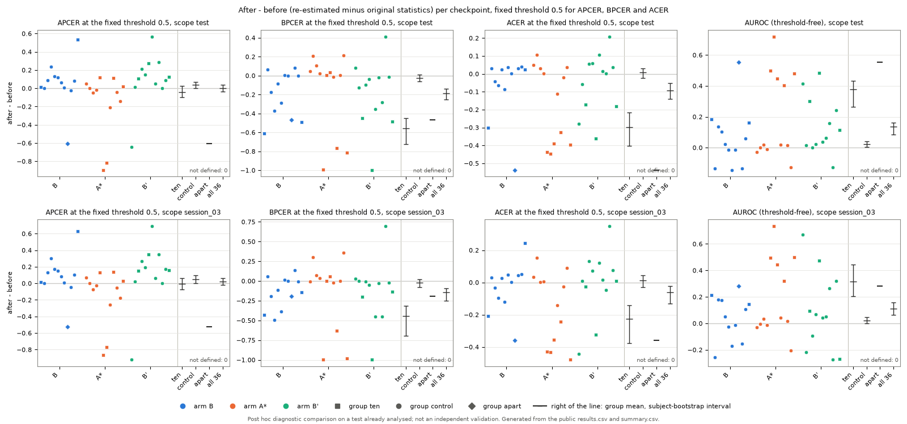

# Report: BatchNormalization re-estimation of PR #27 on the NUAA test, before/after, run `20261117-BNTEST-6245b10`

Status **PASS**, 36 of 36 models (`run/status.json`). Started 2026-11-17T07:55:51+0100 (first line of
`run/run.log.txt`), finished 08:46:19+0100 (`finished`), from the clean commit `6245b10` of the working repository.
Pull request #28, with note, configuration and code at `9aca72b`, was created at 07:55:14 CET (GitHub's `createdAt`,
06:55:14Z), before the start of the run.

The note asks to compare the push time with `started` in `status.json`; the final `run/status.json` has no `started`
field (the runner writes it only in the RUNNING status, which the final status replaces; it keeps `finished` and
`wall_seconds`). The start is therefore read from the first line of `run/run.log.txt`, 2026-11-17T07:55:51+0100,
consistent with `finished` − `wall_seconds` (08:46:19 − 3,027.4 s = 07:55:51.6). The only external timestamp is GitHub's
`createdAt` of this pull request, 2026-11-17T06:55:14Z (07:55:14 CET), with head `9aca72b` (committed 07:53:57+0100), so
the push preceded it; the start time, `finished`, `wall_seconds` and the working-repository commit `6245b10` are our own
records. The configuration, note and code hashes recorded by the run (`config_sha256`, `note_sha256`, `code_sha256` in
`comparison/run_record.json`) equal those of `9aca72b` in `SHA256SUMS`; the architecture hash in `code_sha256` equals
`src/architectures.py` of the repository, outside this folder.

A **post hoc diagnostic extension on a test already analysed, not an independent validation**: the "before" test
metrics are already published (parent run `20261106-SESSABLRUN-d999458`) and the re-estimation was chosen and first
measured on the dev of the same folds (PR #27).

Numbers are read from the public outputs, copied byte for byte in `comparison/` and `run/`, four decimals as in
`comparison/aggregate.md`. Arms: B, A\*, B' (`arm_b`, `arm_a_star`, `arm_b_prime` in the files).

## What was run

The procedure of `NOTE.md`, with the configuration `livenesslab/delivery/bntest/nuaa_bn_test.json` and the runner
`livenesslab/scripts/nuaa_bn_test.py`, both fixed before the run. Each of the 36 patience-4 checkpoints of the parent
run scored the test frames of its fold (3,242, 3,114, 3,439 and 2,819) with its original statistics and again after
the re-estimation of PR #27 (fitting set of its arm and fold, in-memory copy, only `moving_mean` and `moving_variance`
changed); APCER, BPCER and ACER at the fixed threshold 0.5 and AUROC, before and after, on the whole test and on
session 03. What was read of the test (`test_read` in `comparison/run_record.json`):

> this run reads the test: in phase 0 it opens and validates the fold schema (fold<k>_fitting.csv, fold<k>_dev.csv and
> fold<k>_test.csv, as the parent run did) and hashes every <model>_test_scores.csv of the parent run against its
> restricted SHA256SUMS without parsing it; in phase 1 it assembles the test frames of each fold (every frame of the
> held-out subjects, from the cache and the extracted frames, in key order, as the parent run did), scores them with
> each checkpoint and its original statistics with the evaluator of nuaa_bn_recalibration (the parent's own scorer is
> used only on the dev) and parses the parent's <model>_test_scores.csv to compare the per-frame attack probabilities;
> the evaluator also computes a test accuracy and AUROC in memory, which are discarded: no test metric is written or
> logged in phase 1; only if phases 1 and 2 pass for all 36 models, phase 3a reassembles the same test frames and
> scores them with the re-estimated statistics for all 36, the 36 .keras files, the parent's restricted SHA256SUMS and
> the two SHA256SUMS of the BNRECAL run are re-hashed, and only then phase 3b computes the test metrics (APCER, BPCER
> and ACER at the fixed threshold 0.5, AUROC) before and after and, as a reported check, from the parent's stored
> scores; the M2 manifests official_test and cnn_test are read to index the cache; the public aggregate of the parent
> run, which holds test metrics already published, is read only as bytes for its SHA-256 and never parsed; no public
> file of the folds run is opened

As declared in `README.md`, the evaluator of PR #27 also computes accuracy, val_loss and AUROC in memory in phases 1
and 3a; they are discarded, never written or logged.

## Controls

Baseline: 36 of 36 pass (`comparison/baseline.csv`, `baseline_pass`). On the test, same frames as the parent's stored
scores for every model; largest probability difference against those scores 0.0 in all 36 rows
(`test_prob_max_abs_diff`, tolerance 1e-5), 0 decisions changed at 0.5 (`test_discordant_05`), largest softmax gap
3.461e-06 (tolerance 1e-4). On the dev, the PR #27 checks: probability difference 0.0, val_loss within 2.876e-06,
same correct frames in 36 of 36. The before metrics recomputed from the stored scores are equal at 0.5 in 72 of 72
model-scope rows, largest AUROC difference 0.0 (`checks.before_metrics_against_stored_scores`).

Re-estimation: statistics bit-identical to those of the PR #27 run `20261114-BNRECAL-a10a082` for 36 of 36 models
(`statistics_identical_to_pr27` in `comparison/run_record.json`; `comparison/recalibration_check.csv`), dev
probabilities differing by 0.0. At the end the 36 `.keras` files and the anchoring SHA256SUMS were unchanged
(`checks.final`).

## Before/after: all 36 models

Built from `comparison/results.csv` (four decimals); every cell equal to the table "All models" of
`comparison/aggregate.md`. "dev worsened" = 1: the 17 models with a dev or fitting indicator worsened in PR #27.

### Scope `test`

| arm | fold | seed | group | dev worsened (PR #27) | n bona fide | n attack | APCER 0.5 | BPCER 0.5 | ACER 0.5 | AUROC |
|---|---|---|---|---|---|---|---|---|---|---|
| B | 1 | 42 | ten | 0 | 1423 | 1819 | 0.0000 -> 0.0110 | 1.0000 -> 0.3865 | 0.5000 -> 0.1988 | 0.7389 -> 0.9217 |
| A\* | 1 | 42 | control | 1 | 1423 | 1819 | 0.0132 -> 0.0610 | 0.1546 -> 0.2024 | 0.0839 -> 0.1317 | 0.9828 -> 0.9555 |
| B | 1 | 43 | control | 1 | 1423 | 1819 | 0.0038 -> 0.0027 | 0.6430 -> 0.7048 | 0.3234 -> 0.3538 | 0.8948 -> 0.7598 |
| A\* | 1 | 43 | control | 1 | 1423 | 1819 | 0.0000 -> 0.0000 | 0.1026 -> 0.3120 | 0.0513 -> 0.1560 | 0.9921 -> 0.9934 |
| B | 1 | 44 | control | 1 | 1423 | 1819 | 0.0033 -> 0.0902 | 0.7098 -> 0.5369 | 0.3565 -> 0.3135 | 0.6400 -> 0.7759 |
| A\* | 1 | 44 | control | 1 | 1423 | 1819 | 0.0495 -> 0.0011 | 0.2361 -> 0.3450 | 0.1428 -> 0.1731 | 0.8963 -> 0.9165 |
| B | 2 | 42 | control | 0 | 1370 | 1744 | 0.1623 -> 0.4008 | 0.3891 -> 0.0197 | 0.2757 -> 0.2103 | 0.8368 -> 0.9406 |
| A\* | 2 | 42 | control | 1 | 1370 | 1744 | 0.1181 -> 0.0986 | 0.0693 -> 0.0942 | 0.0937 -> 0.0964 | 0.9701 -> 0.9607 |
| B | 2 | 43 | control | 0 | 1370 | 1744 | 0.0688 -> 0.2018 | 0.6270 -> 0.5394 | 0.3479 -> 0.3706 | 0.6701 -> 0.6939 |
| A\* | 2 | 43 | ten | 0 | 1370 | 1744 | 0.0000 -> 0.1181 | 1.0000 -> 0.0051 | 0.5000 -> 0.0616 | 0.5000 -> 0.9972 |
| B | 2 | 44 | control | 0 | 1370 | 1744 | 0.0063 -> 0.1227 | 0.3255 -> 0.0350 | 0.1659 -> 0.0789 | 0.9865 -> 0.9706 |
| A\* | 2 | 44 | ten | 0 | 1370 | 1744 | 1.0000 -> 0.1055 | 0.0000 -> 0.0029 | 0.5000 -> 0.0542 | 0.2782 -> 0.9981 |
| B | 3 | 42 | control | 0 | 1387 | 2052 | 0.1038 -> 0.1696 | 0.3143 -> 0.3216 | 0.2091 -> 0.2456 | 0.8298 -> 0.6852 |
| A\* | 3 | 42 | ten | 0 | 1387 | 2052 | 1.0000 -> 0.1857 | 0.0000 -> 0.0360 | 0.5000 -> 0.1109 | 0.5255 -> 0.9727 |
| B | 3 | 43 | control | 1 | 1387 | 2052 | 0.2003 -> 0.2061 | 0.3107 -> 0.3107 | 0.2555 -> 0.2584 | 0.7776 -> 0.7653 |
| A\* | 3 | 43 | control | 1 | 1387 | 2052 | 0.3289 -> 0.1209 | 0.0382 -> 0.0231 | 0.1836 -> 0.0720 | 0.9534 -> 0.9727 |
| B | 3 | 44 | apart | 0 | 1387 | 2052 | 0.6418 -> 0.0351 | 0.8111 -> 0.3432 | 0.7265 -> 0.1891 | 0.2781 -> 0.8301 |
| A\* | 3 | 44 | ten | 0 | 1387 | 2052 | 0.0000 -> 0.1140 | 1.0000 -> 0.2322 | 0.5000 -> 0.1731 | 0.5000 -> 0.9023 |
| B | 4 | 42 | control | 1 | 925 | 1894 | 0.3590 -> 0.3374 | 0.4281 -> 0.5081 | 0.3936 -> 0.4227 | 0.7502 -> 0.6143 |
| A\* | 4 | 42 | control | 1 | 925 | 1894 | 0.2012 -> 0.1605 | 0.1514 -> 0.1546 | 0.1763 -> 0.1576 | 0.9271 -> 0.9416 |
| B | 4 | 43 | control | 1 | 925 | 1894 | 0.3395 -> 0.4240 | 0.5157 -> 0.5114 | 0.4276 -> 0.4677 | 0.5968 -> 0.6553 |
| A\* | 4 | 43 | control | 1 | 925 | 1894 | 0.3490 -> 0.2091 | 0.0065 -> 0.2205 | 0.1777 -> 0.2148 | 0.9227 -> 0.7956 |
| B | 4 | 44 | ten | 0 | 925 | 1894 | 0.0000 -> 0.5370 | 1.0000 -> 0.5103 | 0.5000 -> 0.5236 | 0.4672 -> 0.6272 |
| A\* | 4 | 44 | ten | 0 | 925 | 1894 | 0.0000 -> 0.0211 | 1.0000 -> 0.1892 | 0.5000 -> 0.1052 | 0.5000 -> 0.9799 |
| B' | 1 | 42 | control | 0 | 1423 | 1819 | 0.6668 -> 0.0220 | 0.3197 -> 0.4034 | 0.4933 -> 0.2127 | 0.5029 -> 0.9156 |
| B' | 1 | 43 | control | 0 | 1423 | 1819 | 0.0082 -> 0.0220 | 0.8180 -> 0.6894 | 0.4131 -> 0.3557 | 0.5857 -> 0.6022 |
| B' | 1 | 44 | ten | 0 | 1423 | 1819 | 0.0000 -> 0.1039 | 1.0000 -> 0.5502 | 0.5000 -> 0.3271 | 0.5000 -> 0.8025 |
| B' | 2 | 42 | control | 0 | 1370 | 1744 | 0.1519 -> 0.3612 | 0.0964 -> 0.0015 | 0.1241 -> 0.1813 | 0.9281 -> 0.9271 |
| B' | 2 | 43 | control | 1 | 1370 | 1744 | 0.2058 -> 0.3584 | 0.5460 -> 0.5102 | 0.3759 -> 0.4343 | 0.6391 -> 0.6623 |
| B' | 2 | 44 | ten | 0 | 1370 | 1744 | 0.0000 -> 0.2735 | 1.0000 -> 0.0036 | 0.5000 -> 0.1386 | 0.5000 -> 0.9845 |
| B' | 3 | 42 | control | 1 | 1387 | 2052 | 0.0643 -> 0.6316 | 0.5984 -> 0.2422 | 0.3314 -> 0.4369 | 0.7411 -> 0.7787 |
| B' | 3 | 43 | control | 1 | 1387 | 2052 | 0.1803 -> 0.2295 | 0.3627 -> 0.3425 | 0.2715 -> 0.2860 | 0.6528 -> 0.7142 |
| B' | 3 | 44 | control | 1 | 1387 | 2052 | 0.0097 -> 0.2958 | 0.3965 -> 0.1146 | 0.2031 -> 0.2052 | 0.7675 -> 0.9255 |
| B' | 4 | 42 | control | 1 | 925 | 1894 | 0.2207 -> 0.2249 | 0.1005 -> 0.5135 | 0.1606 -> 0.3692 | 0.8717 -> 0.7445 |
| B' | 4 | 43 | control | 0 | 925 | 1894 | 0.2761 -> 0.3627 | 0.5157 -> 0.5038 | 0.3959 -> 0.4333 | 0.4826 -> 0.7240 |
| B' | 4 | 44 | ten | 0 | 925 | 1894 | 0.0000 -> 0.1246 | 1.0000 -> 0.5157 | 0.5000 -> 0.3201 | 0.5000 -> 0.6134 |

### Scope `session_03`

| arm | fold | seed | group | dev worsened (PR #27) | n bona fide | n attack | APCER 0.5 | BPCER 0.5 | ACER 0.5 | AUROC |
|---|---|---|---|---|---|---|---|---|---|---|
| B | 1 | 42 | ten | 0 | 925 | 1232 | 0.0000 -> 0.0162 | 1.0000 -> 0.5676 | 0.5000 -> 0.2919 | 0.6134 -> 0.8269 |
| A\* | 1 | 42 | control | 1 | 925 | 1232 | 0.0195 -> 0.0893 | 0.2292 -> 0.2249 | 0.1243 -> 0.1571 | 0.9647 -> 0.9337 |
| B | 1 | 43 | control | 1 | 925 | 1232 | 0.0057 -> 0.0041 | 0.9373 -> 0.9978 | 0.4715 -> 0.5009 | 0.7812 -> 0.5268 |
| A\* | 1 | 43 | control | 1 | 925 | 1232 | 0.0000 -> 0.0000 | 0.0562 -> 0.3589 | 0.0281 -> 0.1795 | 0.9909 -> 0.9879 |
| B | 1 | 44 | control | 1 | 925 | 1232 | 0.0049 -> 0.1331 | 0.9892 -> 0.7935 | 0.4970 -> 0.4633 | 0.3809 -> 0.5595 |
| A\* | 1 | 44 | control | 1 | 925 | 1232 | 0.0722 -> 0.0016 | 0.3222 -> 0.3957 | 0.1972 -> 0.1986 | 0.8401 -> 0.8750 |
| B | 2 | 42 | control | 0 | 1019 | 1364 | 0.2075 -> 0.5117 | 0.5211 -> 0.0255 | 0.3643 -> 0.2686 | 0.7238 -> 0.8991 |
| A\* | 2 | 42 | control | 1 | 1019 | 1364 | 0.1510 -> 0.1261 | 0.0922 -> 0.1256 | 0.1216 -> 0.1259 | 0.9502 -> 0.9364 |
| B | 2 | 43 | control | 0 | 1019 | 1364 | 0.0880 -> 0.2581 | 0.8420 -> 0.7252 | 0.4650 -> 0.4916 | 0.4744 -> 0.5270 |
| A\* | 2 | 43 | ten | 0 | 1019 | 1364 | 0.0000 -> 0.1334 | 1.0000 -> 0.0059 | 0.5000 -> 0.0697 | 0.5000 -> 0.9961 |
| B | 2 | 44 | control | 0 | 1019 | 1364 | 0.0081 -> 0.1569 | 0.4357 -> 0.0461 | 0.2219 -> 0.1015 | 0.9779 -> 0.9521 |
| A\* | 2 | 44 | ten | 0 | 1019 | 1364 | 1.0000 -> 0.1334 | 0.0000 -> 0.0020 | 0.5000 -> 0.0677 | 0.2646 -> 0.9994 |
| B | 3 | 42 | control | 0 | 865 | 1665 | 0.1279 -> 0.2078 | 0.5029 -> 0.5156 | 0.3154 -> 0.3617 | 0.6672 -> 0.4946 |
| A\* | 3 | 42 | ten | 0 | 865 | 1665 | 1.0000 -> 0.2288 | 0.0000 -> 0.0578 | 0.5000 -> 0.1433 | 0.5029 -> 0.9471 |
| B | 3 | 43 | control | 1 | 865 | 1665 | 0.2468 -> 0.2541 | 0.4983 -> 0.4983 | 0.3726 -> 0.3762 | 0.5781 -> 0.5658 |
| A\* | 3 | 43 | control | 1 | 865 | 1665 | 0.4054 -> 0.1489 | 0.0613 -> 0.0370 | 0.2333 -> 0.0930 | 0.9113 -> 0.9546 |
| B | 3 | 44 | apart | 0 | 865 | 1665 | 0.5652 -> 0.0432 | 0.7457 -> 0.5503 | 0.6554 -> 0.2968 | 0.3959 -> 0.6774 |
| A\* | 3 | 44 | ten | 0 | 865 | 1665 | 0.0000 -> 0.1381 | 1.0000 -> 0.3723 | 0.5000 -> 0.2552 | 0.5000 -> 0.8202 |
| B | 4 | 42 | control | 1 | 553 | 1500 | 0.4260 -> 0.3780 | 0.7161 -> 0.8499 | 0.5710 -> 0.6140 | 0.5357 -> 0.3829 |
| A\* | 4 | 42 | control | 1 | 553 | 1500 | 0.2540 -> 0.2027 | 0.0000 -> 0.0000 | 0.1270 -> 0.1013 | 0.9714 -> 0.9872 |
| B | 4 | 43 | control | 1 | 553 | 1500 | 0.4007 -> 0.5067 | 0.8626 -> 0.8553 | 0.6316 -> 0.6810 | 0.2230 -> 0.3315 |
| A\* | 4 | 43 | control | 1 | 553 | 1500 | 0.4393 -> 0.2633 | 0.0108 -> 0.3671 | 0.2251 -> 0.3152 | 0.8788 -> 0.6723 |
| B | 4 | 44 | ten | 0 | 553 | 1500 | 0.0000 -> 0.6313 | 1.0000 -> 0.8535 | 0.5000 -> 0.7424 | 0.1344 -> 0.2809 |
| A\* | 4 | 44 | ten | 0 | 553 | 1500 | 0.0000 -> 0.0267 | 1.0000 -> 0.0181 | 0.5000 -> 0.0224 | 0.5000 -> 0.9973 |
| B' | 1 | 42 | control | 0 | 925 | 1232 | 0.9513 -> 0.0325 | 0.4919 -> 0.5211 | 0.7216 -> 0.2768 | 0.1698 -> 0.8392 |
| B' | 1 | 43 | control | 0 | 925 | 1232 | 0.0114 -> 0.0308 | 1.0000 -> 1.0000 | 0.5057 -> 0.5154 | 0.4761 -> 0.2593 |
| B' | 1 | 44 | ten | 0 | 925 | 1232 | 0.0000 -> 0.1534 | 1.0000 -> 0.7968 | 0.5000 -> 0.4751 | 0.5000 -> 0.5930 |
| B' | 2 | 42 | control | 0 | 1019 | 1364 | 0.1928 -> 0.4619 | 0.0059 -> 0.0010 | 0.0994 -> 0.2314 | 0.9685 -> 0.8756 |
| B' | 2 | 43 | control | 1 | 1019 | 1364 | 0.2632 -> 0.4582 | 0.7341 -> 0.6860 | 0.4986 -> 0.5721 | 0.3946 -> 0.4625 |
| B' | 2 | 44 | ten | 0 | 1019 | 1364 | 0.0000 -> 0.3490 | 1.0000 -> 0.0049 | 0.5000 -> 0.1769 | 0.5000 -> 0.9747 |
| B' | 3 | 42 | control | 1 | 865 | 1665 | 0.0793 -> 0.7706 | 0.8393 -> 0.3884 | 0.4593 -> 0.5795 | 0.5306 -> 0.5749 |
| B' | 3 | 43 | control | 1 | 865 | 1665 | 0.2222 -> 0.2829 | 0.5746 -> 0.5491 | 0.3984 -> 0.4160 | 0.4509 -> 0.5011 |
| B' | 3 | 44 | control | 1 | 865 | 1665 | 0.0120 -> 0.3646 | 0.6335 -> 0.1838 | 0.3228 -> 0.2742 | 0.5907 -> 0.8551 |
| B' | 4 | 42 | control | 1 | 553 | 1500 | 0.2787 -> 0.2813 | 0.1627 -> 0.8590 | 0.2207 -> 0.5701 | 0.7858 -> 0.5129 |
| B' | 4 | 43 | control | 0 | 553 | 1500 | 0.2887 -> 0.4573 | 0.8626 -> 0.8427 | 0.5756 -> 0.6500 | 0.1470 -> 0.4671 |
| B' | 4 | 44 | ten | 0 | 553 | 1500 | 0.0000 -> 0.1567 | 1.0000 -> 0.8626 | 0.5000 -> 0.5096 | 0.5000 -> 0.2328 |

## Paired summaries

From `comparison/summary.csv`: mean of after − before over the models, subject-bootstrap interval, reading, valid
resamples of 1,000, and models lower / equal / higher after. Below zero is a lower error rate; for AUROC, above zero is
a higher AUROC.

| summary | scope | models | subjects (bona fide / attack) | ACER 0.5: after − before [interval] | reading | valid resamples | lower / equal / higher | AUROC: after − before [interval] | reading | valid resamples | lower / equal / higher |
|---|---|---|---|---|---|---|---|---|---|---|---|
| ten (degenerate) | test | 10 | 16 (15 / 15) | -0.2987 [-0.4033, -0.2147] | below | 926 | 9 / 0 / 1 | 0.3790 [0.2635, 0.4344] | above | 926 | 0 / 0 / 10 |
| ten (degenerate) | session_03 | 10 | 16 (9 / 15) | -0.2246 [-0.3759, -0.1425] | below | 650 | 8 / 0 / 2 | 0.3153 [0.2027, 0.4447] | above | 650 | 1 / 0 / 9 |
| controls | test | 25 | 16 (15 / 15) | 0.0082 [-0.0220, 0.0316] | contains | 926 | 7 / 0 / 18 | 0.0237 [0.0039, 0.0396] | above | 926 | 10 / 0 / 15 |
| controls | session_03 | 25 | 16 (9 / 15) | 0.0138 [-0.0295, 0.0424] | contains | 650 | 7 / 0 / 18 | 0.0228 [0.0018, 0.0448] | above | 650 | 12 / 0 / 13 |
| model apart | test | 1 | 4 (3 / 4) | -0.5373 no interval | not_available | 0 | 1 / 0 / 0 | 0.5520 no interval | not_available | 0 | 0 / 0 / 1 |
| model apart | session_03 | 1 | 4 (2 / 4) | -0.3586 no interval | not_available | 0 | 1 / 0 / 0 | 0.2815 no interval | not_available | 0 | 0 / 0 / 1 |
| all 36 | test | 36 | 16 (15 / 15) | -0.0922 [-0.1399, -0.0533] | below | 926 | 17 / 0 / 19 | 0.1370 [0.0863, 0.1598] | above | 926 | 10 / 0 / 26 |
| all 36 | session_03 | 36 | 16 (9 / 15) | -0.0627 [-0.1322, -0.0232] | below | 650 | 16 / 0 / 20 | 0.1113 [0.0645, 0.1586] | above | 650 | 13 / 0 / 23 |
| arm B | test | 12 | 16 (15 / 15) | -0.0707 [-0.1333, -0.0041] | below | 926 | 5 / 0 / 7 | 0.0644 [-0.0282, 0.1224] | contains | 926 | 5 / 0 / 7 |
| arm B | session_03 | 12 | 16 (9 / 15) | -0.0313 [-0.1071, 0.0292] | contains | 650 | 5 / 0 / 7 | 0.0449 [-0.0333, 0.1262] | contains | 650 | 5 / 0 / 7 |
| arm A\* | test | 12 | 16 (15 / 15) | -0.1586 [-0.1937, -0.1160] | below | 926 | 7 / 0 / 5 | 0.2032 [0.1418, 0.2394] | above | 926 | 3 / 0 / 9 |
| arm A\* | session_03 | 12 | 16 (9 / 15) | -0.1523 [-0.1981, -0.1179] | below | 650 | 7 / 0 / 5 | 0.1943 [0.1364, 0.2574] | above | 650 | 4 / 0 / 8 |
| arm B' | test | 12 | 16 (15 / 15) | -0.0474 [-0.1223, 0.0072] | contains | 926 | 5 / 0 / 7 | 0.1436 [0.0811, 0.1895] | above | 926 | 2 / 0 / 10 |
| arm B' | session_03 | 12 | 16 (9 / 15) | -0.0046 [-0.1064, 0.0427] | contains | 650 | 4 / 0 / 8 | 0.0945 [0.0063, 0.2002] | above | 650 | 4 / 0 / 8 |

| summary | scope | models | subjects (bona fide / attack) | APCER 0.5: after − before [interval] | reading | valid resamples | lower / equal / higher | BPCER 0.5: after − before [interval] | reading | valid resamples | lower / equal / higher |
|---|---|---|---|---|---|---|---|---|---|---|---|
| ten (degenerate) | test | 10 | 16 (15 / 15) | -0.0406 [-0.0948, 0.0279] | contains | 950 | 2 / 0 / 8 | -0.5568 [-0.7246, -0.4507] | below | 940 | 8 / 0 / 2 |
| ten (degenerate) | session_03 | 10 | 16 (9 / 15) | -0.0033 [-0.0734, 0.0651] | contains | 950 | 2 / 0 / 8 | -0.4459 [-0.6941, -0.3185] | below | 661 | 8 / 0 / 2 |
| controls | test | 25 | 16 (15 / 15) | 0.0409 [0.0026, 0.0714] | above | 950 | 8 / 1 / 16 | -0.0246 [-0.0600, 0.0130] | contains | 940 | 13 / 1 / 11 |
| controls | session_03 | 25 | 16 (9 / 15) | 0.0490 [-0.0004, 0.0973] | contains | 950 | 8 / 1 / 16 | -0.0214 [-0.0794, 0.0195] | contains | 661 | 13 / 3 / 9 |
| model apart | test | 1 | 4 (3 / 4) | -0.6067 no interval | not_available | 0 | 1 / 0 / 0 | -0.4679 no interval | not_available | 0 | 1 / 0 / 0 |
| model apart | session_03 | 1 | 4 (2 / 4) | -0.5219 no interval | not_available | 0 | 1 / 0 / 0 | -0.1954 no interval | not_available | 0 | 1 / 0 / 0 |
| all 36 | test | 36 | 16 (15 / 15) | 0.0003 [-0.0334, 0.0383] | contains | 950 | 11 / 1 / 24 | -0.1848 [-0.2502, -0.1359] | below | 940 | 22 / 1 / 13 |
| all 36 | session_03 | 36 | 16 (9 / 15) | 0.0186 [-0.0219, 0.0661] | contains | 950 | 11 / 1 / 24 | -0.1441 [-0.2525, -0.0928] | below | 661 | 22 / 3 / 11 |
| arm B | test | 12 | 16 (15 / 15) | 0.0541 [0.0087, 0.1012] | above | 950 | 3 / 0 / 9 | -0.1956 [-0.2880, -0.1083] | below | 940 | 8 / 1 / 3 |
| arm B | session_03 | 12 | 16 (9 / 15) | 0.0850 [0.0305, 0.1442] | above | 950 | 3 / 0 / 9 | -0.1477 [-0.2818, -0.0457] | below | 661 | 8 / 1 / 3 |
| arm A\* | test | 12 | 16 (15 / 15) | -0.1554 [-0.1919, -0.1112] | below | 950 | 7 / 1 / 4 | -0.1618 [-0.2083, -0.1069] | below | 940 | 4 / 0 / 8 |
| arm A\* | session_03 | 12 | 16 (9 / 15) | -0.1541 [-0.1903, -0.1117] | below | 950 | 7 / 1 / 4 | -0.1506 [-0.2170, -0.1101] | below | 661 | 5 / 1 / 6 |
| arm B' | test | 12 | 16 (15 / 15) | 0.1022 [0.0414, 0.1643] | above | 950 | 1 / 0 / 11 | -0.1969 [-0.3181, -0.1204] | below | 940 | 10 / 0 / 2 |
| arm B' | session_03 | 12 | 16 (9 / 15) | 0.1250 [0.0473, 0.2090] | above | 950 | 1 / 0 / 11 | -0.1341 [-0.2746, -0.0995] | below | 661 | 9 / 1 / 2 |

## Figure

After − before per checkpoint (by arm) and group means with subject-bootstrap intervals, whole test (top) and session
03 (bottom); post hoc, not an independent validation.

## Worsenings

Every worsening, however small, is listed with its size in `comparison/aggregate.md` ("Worsening") and flagged in
`comparison/results.csv`. Models per flag, whole test / session 03: `acer_higher` 19 / 20, `apcer_higher` 24 / 24,
`bpcer_higher` 13 / 11, `auroc_lower` 10 / 13.

Among the ten, B fold 4 seed 44 has a higher ACER after: 0.5000 -> 0.5236 on the whole test (APCER 0.0000 -> 0.5370),
0.5000 -> 0.7424 in session 03; in session 03 also B' fold 4 seed 44 (ACER 0.5000 -> 0.5096, AUROC 0.5000 -> 0.2328).
Among the controls: largest ACER increase B' fold 4 seed 42 (0.1606 -> 0.3692; session 03 0.2207 -> 0.5701, BPCER 0.1627
-> 0.8590); largest APCER increase B' fold 3 seed 42 (0.0643 -> 0.6316); largest AUROC decreases on the whole test B
fold 3 seed 42 (0.8298 -> 0.6852), B fold 4 seed 42 (0.7502 -> 0.6143), B fold 1 seed 43 (0.8948 -> 0.7598), and in
session 03 B' fold 4 seed 42 (0.7858 -> 0.5129) and B fold 1 seed 43 (0.7812 -> 0.5268).

## Conclusion

The primary reading, fixed before the run and applied by the script (`comparison/aggregate.md`):

> group ten (10 models), scope test, ACER at the fixed threshold 0.5: mean paired difference (after - before) -0.2987,
> subject-bootstrap interval [-0.4033, -0.2147] entirely below zero: on this test, the effect of this re-estimation on
> these checkpoints is a lower mean value; a post hoc diagnostic reading, not an independent validation, and no
> statement on the cause of the saturation

On these checkpoints, on this test, at the fixed threshold 0.5, the mean ACER of the ten degenerate checkpoints is lower
after the re-estimation, but not for each of them: B fold 4 seed 44 is higher (in session 03 two of the ten are higher,
B fold 4 seed 44 and B' fold 4 seed 44: mean -0.2246 [-0.3759, -0.1425], 8 lower, 2 higher), and the ten do not reach
the same values (ACER after from 0.0542, A\* fold 2 seed 44, to 0.5236, B fold 4 seed 44). Among the ten, APCER is
higher after for 8 of 10 (whole test -0.0406 [-0.0948, 0.0279], session 03 -0.0033 [-0.0734, 0.0651], intervals
containing zero). For the 25 controls the ACER interval contains zero (18 higher, 7 lower) and their APCER is higher on
average, with an interval above zero. This makes no statement on the cause of the dev saturation, is not an independent
validation and is not a recommendation to re-estimate the statistics of the controls or of any other checkpoint.

## Limits

- Post hoc on a test already analysed; one estimator, one threshold (0.5), the restored checkpoint of each training.
- Controls: ACER 0.0082 [-0.0220, 0.0316] on the whole test, 0.0138 [-0.0295, 0.0424] in session 03; APCER 0.0409
  [0.0026, 0.0714] on the whole test (session 03: 0.0490 [-0.0004, 0.0973]).
- Arms: APCER rises in B (0.0541 [0.0087, 0.1012]; session 03 0.0850 [0.0305, 0.1442]) and B' (0.1022 [0.0414,
  0.1643]; 0.1250 [0.0473, 0.2090]), intervals above zero. The ACER interval contains zero for B' on the whole test and
  for B and B' in session 03.
- 16 held-out subjects, four per fold (15 with bona fide, 15 with attack frames on the whole test). Session 03 rests
  on nine subjects with bona fide frames (2, 3, 2, 2 per fold) and fewer valid resamples: 650 for ACER and AUROC, 661
  for BPCER, against 926 and 940 on the whole test (APCER 950 in both). With so few clusters a percentile interval may
  be too narrow.
- The model apart (B fold 3 seed 44: one fold, four subjects) has no interval.
- Arms and groups share models and subjects: the summaries are not independent.
- Resamples dropped for an undefined metric are reported, not corrected; the arm B AUROC interval contains zero in both
scopes (0.0644 [-0.0282, 0.1224]; 0.0449 [-0.0333, 0.1262]).
- Runner defect: the final `run/status.json` has no `started` field (written only in the RUNNING status), so the start
time rests on `run/run.log.txt` (see the header).

## Time and CPU

Wall time 3,027.4 s, 50.5 minutes (`run/status.json`; `comparison/aggregate.md`, "Time"), against the note's estimate
of about 42 minutes (upper about 112) and the cap of 240 minutes of elapsed time, not reached. Phases
(`timings.phases`): baseline 744.3 s, re-estimation 1,607.1 s, scoring after 664.6 s; the four other phases
below 4 s each.

The process CPU time over all threads is **18,438.4 s** (`process_cpu_seconds` in `comparison/run_record.json`; printed
as 18438 s in `aggregate.md` and 18440 s in `run.log.txt`), that is 5.12 hours, about 6.1 times the wall time: **more
than four hours of CPU time**. The coordinator's limit was "entro 4 ore CPU". The note, published before the run, says
that "the four-hour limit is applied as elapsed time (the cap above); process CPU time over all threads is recorded, not
capped or estimated, and can exceed the elapsed time" (`NOTE.md`, section 7), and the README at `9aca72b` ("Time") calls
the cap "the four-hour limit as elapsed time of a CPU-only run". Counted as CPU time over all threads, this run exceeded
four hours; whether the limit as applied is acceptable is left to the coordinator's judgement.

## Declarations

- No training; no trained parameter changed; no `.keras` file written.
- What was read of the test: the field `test_read` quoted above.
- Procedure, tolerances, reading rule and outputs were fixed before the run and not changed after any test result was
  seen; every outcome is reported. Threshold fixed at 0.5, none selected.
- No statement on the cause of the dev saturation.
- No subject or frame identifier in the public outputs; per-frame test scores, re-estimated statistics and per-subject
  results are delivered in the shared restricted N1 folder (folder `20261117-BNTEST-6245b10`).
