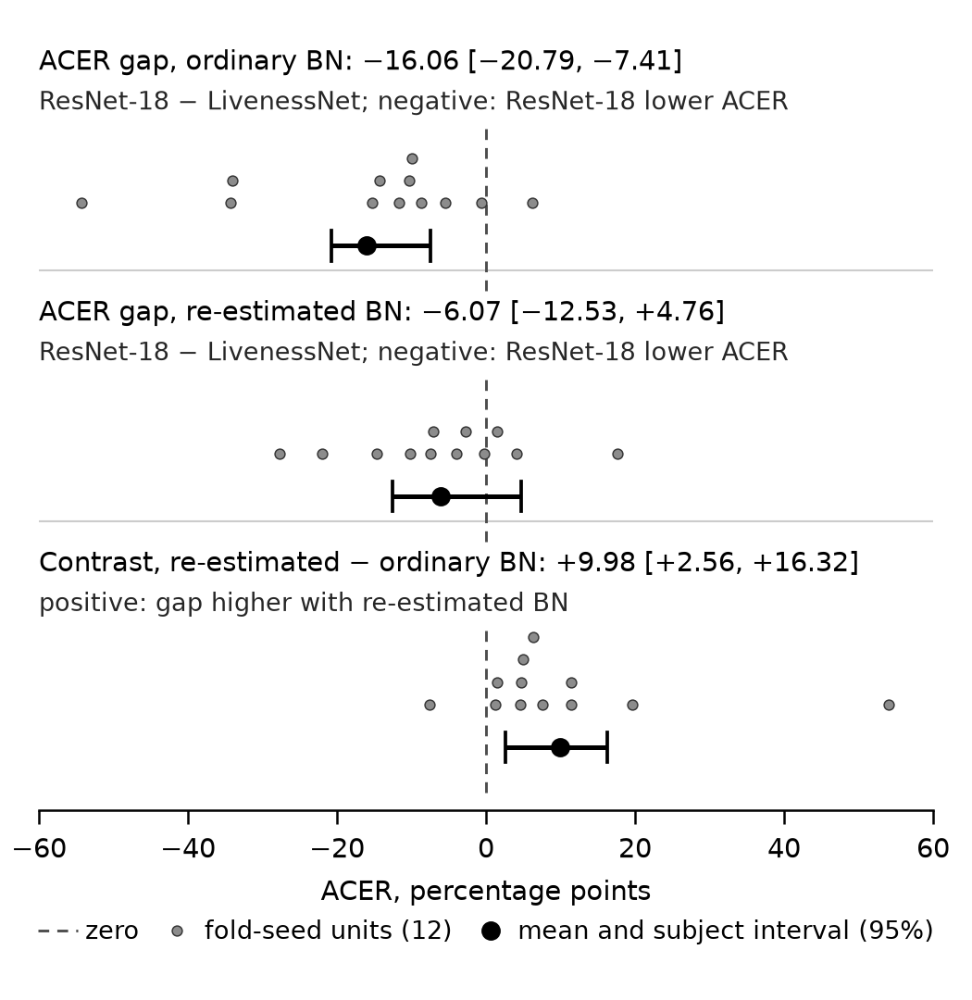

# LivenessNet and ResNet-18 on NUAA: table, figure, per-seed appendix and note for the first draft, from the public files of PR #32

Asked by the coordinator on the C2 card on 21 November 2026 at 13:21, after merging PR #32 (merge `81ba5fd` into
`research/pad-2026`): a table with APCER, BPCER and ACER of the two networks in the two BN states (patience 4,
threshold 0.5); a figure with the two ACER gaps and their contrast, with the subject intervals; the three seeds
separately, in an appendix; the CSV and the script that regenerate table and figure from the public files of PR #32; a
brief note on the 16 subjects, on the reuse of the LivenessNet cells and on the fact that after the re-estimation the
interval of the gap includes zero. "Per questo passaggio bastano i risultati già disponibili" (for this step the
results already available are enough).

| request | where it is in this folder |
|---|---|
| table: APCER, BPCER and ACER of the two networks in the two BN states | `outputs/primary_table.md` (Table 1 (a), with the gaps and the contrast in (b)), `outputs/primary_table.tex`; full precision in `outputs/primary_table.csv` |
| figure: the two ACER gaps and their contrast, with the subject intervals | `outputs/figure_acer_gaps.png`, `outputs/figure_acer_gaps.pdf`; the plotted values in `outputs/figure_acer_gaps_data.csv`; a caption in `NOTE.md` |
| the three seeds separately, in an appendix | `outputs/per_seed.md`, `outputs/per_seed.csv` |
| the CSV and the script | `outputs/primary_table.csv`, `outputs/per_seed.csv`, `outputs/figure_acer_gaps_data.csv`; `make_table_figure.py` |
| the note | `NOTE.md` |

**Status of this delivery.** Every value of the tables, of the figure and of the note comes from three public files
of PR #32, `research/pad-arch-eval-results/runs/20261121-ARCHEVAL-332fbdf/public/` (`units.csv`, `results.json`,
`conditions.csv`), read by `make_table_figure.py` after checking them against the `SHA256SUMS` of that directory. The
other sources are named where they are used: the pinned SHA-256 of that `SHA256SUMS` is `public_sha256sums_sha256` of
`status.json` of PR #32 (checked by the tests); the resampling recipe (1,000 resamples, percentiles 2.5–97.5) is that
of `PROTOCOL.md` §6 and of the README of PR #32; the reuse of the LivenessNet cells (PR #21, PR #28) is from
`PROTOCOL.md` §5. No new reading of the NUAA test, no training, no restricted file, no TensorFlow; the evaluation code
and the files of PR #32 are unchanged.

## Results (percentage points)

From `outputs/primary_table.md`: the proportions (0 to 1) of the source files × 100, two decimals. Gap =
metric(ResNet-18) − metric(LivenessNet), mean over the 12 fold-seed units; contrast = gap with re-estimated BN − gap
with ordinary BN; subject interval in brackets (individual 95% intervals, copied from `results.json`).

| network | BN state | APCER | BPCER | ACER |
|---|---|---:|---:|---:|
| LivenessNet | ordinary | 15.74 | 58.95 | 37.35 |
| ResNet-18 | ordinary | 33.75 | 8.83 | 21.29 |
| LivenessNet | re-estimated | 21.15 | 39.40 | 30.28 |
| ResNet-18 | re-estimated | 36.72 | 11.69 | 24.20 |

| quantity | ACER | units: ResNet-18 lower / LivenessNet lower / ties | label of `results.json` |
|---|---|---|---|
| gap, ordinary BN | −16.06 [−20.79, −7.41] | 11 / 1 / 0 | "ResNet-18 lower" |
| gap, re-estimated BN | −6.07 [−12.53, +4.76] | 9 / 3 / 0 | "unresolved" (interval contains zero) |
| contrast | +9.98 [+2.56, +16.32] | the gap of 2 of 12 units changes sign (reported apart) | "ACER difference (ResNet-18 - LivenessNet) higher with re-estimated BN" |

Valid resamples: 926 of 1,000 for ACER (950 for APCER, 940 for BPCER), the same in every block and seed (checked). The
APCER and BPCER gaps and contrasts, with their intervals, are in Table 1 (b); the per-seed values in the appendix. The
rounded values agree with those written by the coordinator on 21 November 2026: 9.98 in the comment on the C2 card;
−16.06, −6.07, +9.98, +2.56 and +16.32 in the description of the C2 card.



## Inputs and what the script checks

`make_table_figure.py` reads, from the input directory (by default
`../pad-arch-eval-results/runs/20261121-ARCHEVAL-332fbdf/public` relative to this folder; `--inputs` changes it), only
`SHA256SUMS`, `units.csv`, `results.json` and `conditions.csv`. `report.md` and `reproduction.csv` are listed in that
`SHA256SUMS` but are neither opened nor hashed: the script does not detect a change in them
(`shasum -a 256 -c SHA256SUMS` in that directory does). In this order, stopping with an English error message, exit
code 1 and nothing written if a check fails:

1. Options and paths, before any input is read (below, "Refusals").
2. Integrity: the SHA-256 of the input `SHA256SUMS` must be the value pinned in the script,
   `c8a5d339d73da3826e95620dad586015989461ffe04b1cd26bb8c9b2bb19ffeb`, which is `public_sha256sums_sha256` of
   `runs/20261121-ARCHEVAL-332fbdf/status.json` of PR #32 (checked by the tests); `SHA256SUMS` must be ASCII, end with
   a newline and list exactly the five public files, once each, in well-formed lines; each file read must have the
   SHA-256 of its line. The bytes checked are the bytes parsed (a file replaced while it is opened is refused).
3. `results.json`: an object; `schema` `pad-arch-eval/1`, `run_id` `20261121-ARCHEVAL-332fbdf`, `status` `PASS`,
   `official` true; the two primary conditions are patience 4 with threshold `fixed_0.5`, ordinary and re-estimated
   BN; `checks_before_primary_analysis`: 12 combinations at threshold 0.5 in the plan and 12 units with effective
   threshold 0.5 for LivenessNet and for ResNet-18 in each of the two conditions; 4 positive frame counts and one
   SHA-256 of the frame identifiers per fold. Values are compared with their types (12.0 is not 12); duplicate keys,
   non-finite numbers, invalid JSON or UTF-8 are refused, and any other unexpected structure stops with "unexpected
   structure of the input files" (no traceback).
4. `units.csv`, every one of its 96 rows (2 patiences × 2 BN states × 2 thresholds × 12 units, each once): exact
   header and field count; condition, fold and seed in the plan; threshold 0.5 for both networks at `fixed_0.5`, a
   number between 0 and 1 at `dev_eer`; every rate an exact fraction, written reduced, between 0 and 1; ACER = (APCER
   + BPCER) / 2 for each network; each gap = ResNet-18 − LivenessNet; `delta_acer_value` and `tie` consistent with the
   exact gap; `n_frames` and `frame_ids_sha256` equal to those of `results.json` for the fold.
5. `primary_analysis.rows` of `results.json`, unit by unit: 12 units of the plan, once each; the exact gaps in both
   states and the exact contrast, and their floating-point values, equal to those computed from `units.csv`.
6. `conditions.csv`, field by field: its 8 primary rows (two BN states × all seeds and each seed) equal to the
   corresponding blocks of `results.json`.
7. Cross-checks, for all seeds and for each seed: the mean gaps (APCER, BPCER, ACER) computed from the exact fractions
   of `units.csv` reproduce `mean_delta` of `results.json` exactly (the floating-point value of the exact mean equals
   the value written); the mean contrasts reproduce `mean`; the unit counts (11 / 1 / 0 with ordinary BN, 9 / 3 / 0
   with re-estimated BN, all seeds) reproduce `acer_counts`; `units` of the contrast is the number of units; the units
   whose gap changes sign (strictly negative in one state and strictly positive in the other: 2 of 12; 1, 0 and 1 for
   seeds 42, 43, 44) reproduce `units_changing_sign`; `n_subjects` is 16 in every block; the labels `sign` and
   `reading` follow the rules of `PROTOCOL.md` §6 on their ACER interval (a bound at zero contains zero), also per
   seed; every interval has low ≤ high, contains its own mean and has between 1 and 1,000 valid resamples; the valid resamples of each metric are
   the same in every block and seed, since the generated texts state one number per metric; `per_seed` holds exactly
   seeds 42, 43 and 44; `one_class` holds one count "k of n evaluable" per network and BN state at patience 4.

The subject intervals and their valid resamples are copied from `results.json`
(`primary_analysis.<gap_ordinary, gap_re_estimated, contrast>.interval` and the same under `per_seed`): they cannot
be recomputed from the public files, which hold no per-subject counts. The script checks their form, that each
contains its own mean (a plausibility check, true for all 36 intervals: 4 scopes × 3 quantities × 3 metrics) and
the labels that depend on them, not their values. The column `interval_source` of the CSVs says it for each row.

**Generated sentences.** Every sentence of the tables that states a fact of the data is built from the data: the
valid resamples (from all blocks, after checking that they agree), the sentence on the change of sign between the two
BN states (from the two labels), the models that decide every test frame as the same class (from `units.csv`), the
pre-registered one-class count on the dev (from `one_class`), the test frames per fold, the values that round to
0.00. The other notes are fixed text: note 1 states what the script requires (it stops otherwise), note 2 an identity
of the means, notes 4 and 7 the rules of `PROTOCOL.md` §6 and §5.

## Outputs

All outputs are computed in memory first. `--out DIR` then writes the 8 files, each created exclusively
(`O_CREAT | O_EXCL`, which also refuses a symbolic link in place of a file) and synchronised to disk, in a hidden
temporary directory `.mtf-…` created next to `DIR` (in the same parent, tested, so the final rename never crosses
file systems, which would fail with `EXDEV`). It then reserves the name `DIR` with an exclusive `mkdir`, records
the device and inode of the reservation, checks immediately before the rename that `DIR` is still that empty
reservation, and renames the temporary directory onto it; `DIR` ends in mode 0755 (tested). The rename is the only
point at which the outputs are delivered.

*Anything else under the name `DIR`.* A directory (empty or not), a file or a symbolic link that takes the name `DIR`
after the checks, before the reservation, is never replaced (each of the four tested); an empty directory that replaces
the reservation before the inode check is recognised by its inode and neither replaced nor removed (tested); a file
written into the reservation, or a file put in its place, makes the rename fail and is kept (both tested). In every
such case the run stops with "the output name or the temporary directory was taken by another process after the
checks; nothing was written by this run", and an object of another process that took the place of the temporary
directory is never removed (tested). If another process changes the temporary directory after the reservation, or
moves the output away after the rename, so that `DIR` is not the directory of this run, the run says so without naming
any signal: "the output name or the temporary directory changed during the rename; nothing was delivered by this run",
exit code 1 (tested for a directory put in place of the temporary directory before the rename, which the rename then
puts under the name `DIR` without removing it, and for an output moved away after the rename). The
only window left is the instant between the inode check and the rename: an empty directory put in place of the
reservation exactly there would be replaced by the rename (nothing is lost, since it is empty; not tested).

*Signals.* While the files are written, `SIGINT`, `SIGTERM` and `SIGHUP` are only recorded (the handlers never raise);
the run looks at them after each file, before the reservation and before the rename. What is printed and the exit code
are decided from the state on disk, not from where an exception surfaced: if `DIR` is the temporary directory of this
run (same device and inode), the outputs are delivered and the run ends with "written 8 files to DIR; signal N
received, handled after the outputs were complete" and `RESULT: PASS`, exit code 0; otherwise it removes only what it
created, recognised by device and inode (its temporary directory and its own empty reservation), and ends with
"interrupted by signal N; nothing was left in DIR", exit code 1; a run interrupted before the reservation does not
create it. Tested with a real process, started with the default handlers as from a terminal, that receives each of the
three signals from outside at five points (before the reservation, between the reservation and the rename, right after
the rename, during the restoration of the handlers, after it), both with matplotlib imported and the real figure drawn
and with a substitute build that loads no matplotlib: the
first two points give "nothing was left" and no `DIR`; the next two give the 8 outputs and the sentence above; after
the restoration, the handler the process had before applies again (from the command line: `SIGINT` gives the same
sentence, `SIGTERM` and `SIGHUP` end the process by the signal, with the 8 outputs complete and no "nothing was left"
message). An error after the reservation (a rename that fails) removes the reservation (tested). After `SIGKILL` or a
power loss only the hidden temporary directory, or the empty reservation `DIR`, may remain (tested for `SIGKILL`
between the reservation and the rename); never a directory with the output name and some of the files. Nothing is
written outside `DIR` and its temporary sibling. matplotlib may update its
own font cache in its configuration directory; that does not depend on this script.

| file | what it is |
|---|---|
| `primary_table.csv` | one row per network × BN state (mean over the 12 units of APCER, BPCER, ACER: value and exact fraction) and one row each for the gap with ordinary BN, the gap with re-estimated BN and the contrast (mean, exact fraction, interval low and high and valid resamples for each metric, unit counts or units changing sign, label and reason of `results.json`, source of the interval); proportions between 0 and 1, full precision |
| `primary_table.md` | Table 1 in percentage points, with its notes (units and rounding, sources, intervals, labelling rules, change of sign, models that decide every test frame as one class, test frames per fold, reuse of the LivenessNet cells) |
| `primary_table.tex` | Table 1 (a) and the values with intervals of Table 1 (b) in LaTeX (`tabular`, no package needed); unit counts, labels and notes are in `primary_table.md` |
| `per_seed.csv`, `per_seed.md` | the same quantities over the 4 units of each seed, the rates of each network included, with the per-seed intervals of `results.json` (`primary_analysis.per_seed`); reported apart, not part of the reading |
| `figure_acer_gaps_data.csv` | the values plotted: for each of the three quantities the mean, the interval bounds (with the valid resamples) and the 12 unit values with their vertical level, as proportions (full precision) and in points |
| `figure_acer_gaps.png`, `figure_acer_gaps.pdf` | the figure, drawn only from the values of the data file |

**Units and typography.** The CSVs keep the proportions of the source files (0 to 1): the means of the networks as the
floating-point value and the exact fraction of the mean of the 12 (or 4) exact fractions of `units.csv`; the gaps and
the contrast as the values of `results.json` (equal to the floating-point value of the exact mean, checked) and as
the exact fraction. Tables, note and figure are in percentage points: × 100, two decimals, rounded half away from zero
from the exact value (the fraction, or the decimal written in `results.json`); one function, `points`, does it.
Signed quantities carry their sign, also when the rounded value is 0.00 (one case: `−0.00`, the lower bound of the
BPCER contrast of seed 44, −0.0037 points, explained in `per_seed.md`). Typography: in the Markdown tables, in
`NOTE.md`, in this README and in the figure a negative number is written with the minus sign U+2212 (`−`); in the
CSVs, in `primary_table.tex` (as `$-…$`) and in the labels quoted from `results.json` (for example
"ACER difference (ResNet-18 - LivenessNet) …") with the ASCII hyphen-minus.

**Denominators.** Test frames per fold, from `n_frames` of `units.csv` (equal to `test_frames_per_fold` of
`results.json`): 3242, 3114, 3439, 2819; in each fold both networks and both BN states are scored on the same frames
(same `frame_ids_sha256`). The number of frames per class is not in the public files: the fractions of `units.csv`
are written reduced (for example `30/107`) and are not denominators.

**Models that decide every test frame as one class.** At threshold 0.5 with ordinary BN, two LivenessNet models, fold
1 seed 42 and fold 4 seed 44, decide every test frame as attack (APCER 0, BPCER 1, ACER 1/2 in `units.csv`); they
enter the means like the others (note 5 of Table 1, written by the script from `units.csv`). No other model of the two
primary conditions decides every test frame as one class. The term "one-class run" of `PROTOCOL.md` §6 is a different
measure, on the dev at threshold 0.5: `one_class` of `results.json` gives 2 of 12 evaluable LivenessNet models at
patience 4 with ordinary BN and 0 of 12 for the other three network × BN state pairs (also in note 5); the README of
PR #32 says that the two models one-class on the dev are the same two models.

**Figure.** Intended width: one column, 3.5 inches (89 mm), at 100% (fonts 6.5–7 pt; PNG at 300 dpi). One row per
quantity, with its value and interval written above it and a direction hint ("negative: ResNet-18 lower ACER" for the
gaps, "positive: gap higher with re-estimated BN" for the contrast); the mean (black dot) and the subject interval
(black bar); the 12 unit values (grey dots with a dark edge) above the bar; a dashed zero line in each row. Unit points
closer than 2.0 points on the axis are stacked vertically by a fixed rule: in ascending order of value (ties by fold
and seed), each point takes the lowest level with no point of the same row less than 2.0 points to its left (`level`
in the data file). Symmetric axis from −60 to +60 points (the next multiple of 10 above the largest absolute value).

## Commands

From this folder, with Python 3 (standard library only for tables and CSVs) and matplotlib for the figure. The scripts
have no shebang and are not executable: run them with `python3 -I -B`.

```bash
python3 -I -B make_table_figure.py --check
```

Regenerates everything in memory and compares it byte for byte with `outputs/` (`--against` changes the directory),
writing nothing. Expected, with the environment below (`test_logs/make_table_figure_check.txt`):

```
primary_table.csv: identical
primary_table.md: identical
primary_table.tex: identical
per_seed.csv: identical
per_seed.md: identical
figure_acer_gaps_data.csv: identical
figure_acer_gaps.png: identical
figure_acer_gaps.pdf: identical
RESULT: PASS
```

**The bytes of the PNG and PDF depend on the versions of matplotlib, FreeType and the font** (here matplotlib 3.11.2
with FreeType 2.14.3 and its bundled DejaVu Sans, Python 3.11.16, macOS on arm64); with other versions the two images
may differ while the plotted values do not. The comparison that does not depend on them is:

```bash
python3 -I -B make_table_figure.py --check --text-only
```

Expected (`test_logs/make_table_figure_check_text_only.txt`, Python 3.14.7 without matplotlib): the six text files
`identical`, `figure_acer_gaps.png: structure valid, content not compared (--text-only)`, the same for the PDF, and
`RESULT: PASS`. Under `--text-only` the images are checked only in their form: for the PNG the signature, the CRC of
every chunk and the final `IEND` (any changed byte breaks a CRC), for the PDF the `%PDF-` header and the final `%%EOF`.
Without matplotlib, `--check` alone stops with "matplotlib is not available: the figure cannot be generated (with
--check, --text-only compares the tables and the figure data without it)".

`--check` accepts only a directory that holds exactly the 8 outputs: any other file, a `.DS_Store` written by the
macOS Finder included, makes it stop ("the directory to check holds …"); delete it and run again.

```bash
rm -r outputs && python3 -I -B make_table_figure.py --out outputs
```

Expected: `written 8 files to …/outputs` and `RESULT: PASS`; with the environment above, the 8 files are those of the
commit (`outputs/` itself was written this way). The PNG and PDF carry no software name and no date (`metadata` of
`savefig`); matplotlib's default settings are restored before drawing, so a local `matplotlibrc` does not change the
figure (tested).

**Rule for the output directory.** It must not exist; it may not be an input or the input directory, nor lie inside
the input directory or inside the results package that holds it (the folder of which the inputs are
`runs/20261121-ARCHEVAL-332fbdf/public`, here `../pad-arch-eval-results/`); inside this folder only `outputs/` itself
is allowed, the documented regeneration target. Paths are compared by file identity on the resolved path and its
ancestors, so a symbolic link to one of these places is refused too.

**Refusals** (each with an English message, exit code 1 and nothing written): the input directory missing, a symbolic
link or not a directory; an input file missing, a symbolic link or not a regular file (directory, FIFO); the output
directory against the rule above, already existing (also as a symbolic link, dangling or not), or with a missing
parent or a parent that is not a directory; a directory, file or symbolic link that takes the output name after the
checks, for example another run on the same directory ("the output name or the temporary directory was taken by
another process after the checks; nothing was written by this run"; see "Anything else under the name `DIR`" above);
for `--check`, a directory to check that is missing, a symbolic link, not a directory, the input directory, holds
other files than the 8 outputs, or holds a symbolic link in place of one. Incompatible or repeated options (`--out`
with `--check`, neither, `--against` or `--text-only` without `--check`, an option given twice, abbreviated or unknown
options) stop with exit code 2 before any input is read.

## Choices of the author

- Percentage points with two decimals, rounded half away from zero from the exact value; sign kept on values that
  round to 0.00, with a sentence that gives the value.
- The rates of each network: plain mean over the 12 units (4 per seed in the appendix), each unit with the same
  weight, as the mean gaps of `results.json`; no interval is published for them, and none is added.
- Table 1 (b) also gives the APCER and BPCER gaps and contrasts with their intervals, which `results.json` holds; the
  column of unit counts (ResNet-18 lower / LivenessNet lower / ties) and, for the contrast, "gap changes sign in k of
  n".
- The appendix (a) gives the rates of each network per seed.
- Notes 5 (models that decide every test frame as one class, with the pre-registered count on the dev) and 6 (test
  frames per fold) of Table 1.
- The labels in the tables are those of `results.json` (`sign`, `reading`), re-checked against the rules.
- The figure: layout, direction hints, the 12 unit values as points with the stacking rule above, the symmetric axis,
  single-column size.
- `conditions.csv` is read only for the cross-check with `results.json`.
- A LaTeX version of Table 1.
- In `NOTE.md`, a suggested caption and, under its own final heading "Addition of the author (not requested, not
  pre-registered)", a post-hoc description computed from `units.csv` alone.

## Limits

- The subject intervals are not recomputed here (no per-subject counts in the public files); the script checks their
  form, that each contains its own mean, and the labels that depend on them, not their values.
- 16 test subjects, all from NUAA, pooled over the 4 folds; individual 95% intervals, no correction for multiplicity;
  3 seeds, paired only nominally (`PROTOCOL.md` §10).
- The LivenessNet side of the primary analysis repeats cells already read on this test (PR #21, PR #28); only the
  ResNet-18 side is new: not an independent validation (`PROTOCOL.md` §5). Any result applies only to these networks,
  recipe and data.
- The image bytes depend on the software versions (above); `report.md` and `reproduction.csv` are not checked by the
  script.

## Checks

```bash
python3 -I -B check_make_table_figure.py
```

Standard library only (`unittest`), plus matplotlib for the tests that generate or compare the images. The tests run
on copies of the public files in temporary directories (`TMPDIR` must lie outside this folder and the results package:
checked before anything is created) and never write in this folder or in the results package (files and directories
checked at the end). Each declared check has a hostile fixture that makes that check fire: the fixtures rewrite
`SHA256SUMS` and replace the pinned value inside the test, so that the rule fires, not the checksum; for unit counts,
ties and the models that decide every frame as one class, the tests rebuild a consistent set of files (fractions,
means, counts, rows) with their own code.

Expected with matplotlib (`test_logs/check_make_table_figure.txt`):

```
tests run: 90, failures: 0, errors: 0, skipped: 0
RESULT: PASS
```

Without matplotlib (`test_logs/check_make_table_figure_without_matplotlib.txt`, Python 3.14.7 without matplotlib), the
9 tests that generate or compare the images (including the signal tests that draw the real figure) are
skipped with the declared reason ("matplotlib is not installed:
the tests that generate or compare the figure images are skipped"), the only skip the suite admits:

```
tests run: 90, failures: 0, errors: 0, skipped: 9
RESULT: PASS
```

```bash
python3 -I -B check_make_table_figure_mutations.py
```

Applies, one at a time in a temporary copy of this folder and of the results package, 64 mutants of
`make_table_figure.py` (each removes or weakens one declared check; their names and descriptions are in the log) and
runs the suite on each; the unmutated copy must pass first; three equivalent mutants are listed apart, with the reason,
and not counted. `TMPDIR` must lie outside this folder and the results package (checked). Expected
(`test_logs/check_make_table_figure_mutations.txt`):

```
mutations killed: 64/64
RESULT: PASS
```

Without matplotlib the mutant R19 (matplotlib defaults not restored) cannot be verified and is never counted as killed
(`RESULT: INCOMPLETE`, exit code 2). Each log of `test_logs/` gives in its header which interpreter `python3` was
(Python 3.11.16 with matplotlib 3.11.2, or Python 3.14.7 without matplotlib) and the literal command. Nothing was run on
Linux by the author.

From this folder:

```bash
shasum -a 256 -c SHA256SUMS
```

Expected: 18 lines `OK`.

## Contents

19 files: 18 listed in `SHA256SUMS`, plus `SHA256SUMS`. One file matches the `.gitignore` of
the repository (`*.png`): `outputs/figure_acer_gaps.png`; it is committed explicitly
(`git ls-files research/pad-arch-eval-paper | wc -l` gives 19 after the commit).

| path | what it is |
|---|---|
| `README.md` | this file |
| `NOTE.md` | the brief note for the article: the 16 subjects and the intervals, the reuse of the LivenessNet cells, the interval of the gap that contains zero after the re-estimation, a suggested caption for the figure, and an addition of the author |
| `make_table_figure.py` | the script |
| `check_make_table_figure.py` | the tests |
| `check_make_table_figure_mutations.py` | the mutation check |
| `outputs/` | the 8 files above |
| `test_logs/` | the outputs of the tests (with and without matplotlib), of the mutation check and of `--check` |
| `SHA256SUMS` | SHA-256 of every other file of this folder |

## Declarations

No new reading of the NUAA test, no training, no restricted file, no external dataset; the files of PR #32 are read,
not changed.
