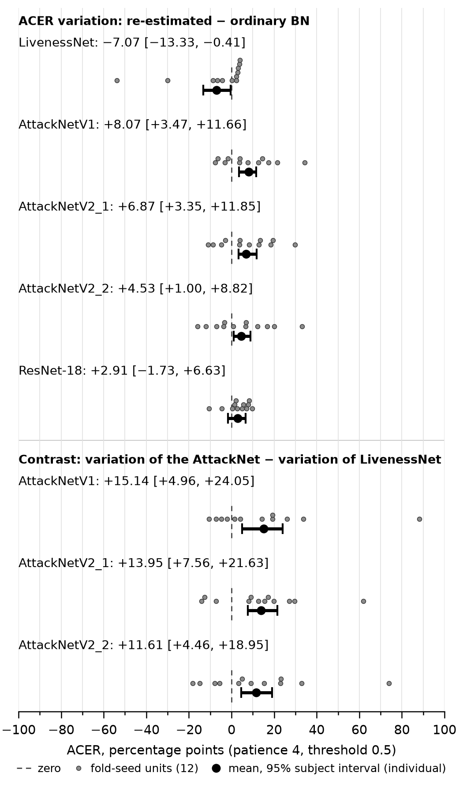

# The five networks on NUAA under BN re-estimation: table, figure, appendices and aggregated CSV for the article, from the public files of the C5 evaluation

Delivery for the article asked on the C5 card ("Consegna per l'articolo": a table of the five networks with APCER,
BPCER, ACER and denominators, a figure of the ACER variations with intervals, the per-seed results and the counts of
the one-class cases in an appendix, the unfavourable results kept, the aggregated CSV and the script that regenerates
table and figure; the individual scores stay in the restricted repository), and in `PROTOCOL.md` §11 of the C5
comparison (pull request #34). The primary analysis is the one fixed on the card: patience 4 and threshold 0.5, the
ACER variation of each network (re-estimated BN minus ordinary BN, in percentage points) and, for each AttackNet, the
contrast of its variation with that of LivenessNet, with paired subject bootstrap intervals that are individual 95%
intervals. Patience 12, the EER threshold and the rankings are descriptive analyses.

| request | where it is in this folder |
|---|---|
| table of the five networks: APCER, BPCER, ACER and denominators | `outputs/primary_table.md`, Table 1 (a) (units, attack frames, bona fide frames, subjects), with the variations in (b) and the three contrasts in (c); `outputs/primary_table.tex` |
| figure of the ACER variations with intervals | `outputs/figure_acer_variations.pdf` (vector) and `.png`: the five variations and the three contrasts, mean and subject interval, with the 12 unit values |
| per-seed results, in an appendix | `outputs/appendix_per_seed.md`: per seed (rates, variations and contrasts with the per-seed intervals), per network × fold × seed, and per fold |
| counts of the one-class cases, in an appendix | `outputs/appendix_single_class.md` and `outputs/single_class.csv`: on the test (§6 (f), descriptive) and on the dev (§6 (f), pre-registered), with the not evaluable models |
| aggregated CSV | `outputs/aggregate.csv`: every value of the tables and of the figure, the 8 conditions |
| script that regenerates table and figure | `make_table_figure.py` |
| descriptive analyses (patience 12, EER threshold, comparison with ResNet-18, leaving one unit out, rankings) | `outputs/descriptive.md` |

**Status of this delivery.** Every value of the outputs comes from the public files of the evaluation
`20261124-ANETEVAL-7c22b1a` (the record published in `../pad-attacknet-eval-results/runs/20261124-ANETEVAL-7c22b1a/`):
`status.json` and the files listed in `public/SHA256SUMS`; the counts on the dev come from the public files of the
eight runs it evaluates (`../pad-attacknet-eval/runs/<run id>/` for the six AttackNet runs,
`../pad-arch-eval/runs/<run id>/` for the two C2 runs): `status.json`, `public/SHA256SUMS`, `public/one_class.csv` and
`public/models.csv`. The script never opens `restricted/` (the per-frame scores) of the record or of a run.
No new reading of the NUAA test, no training, no TensorFlow; the evaluation and its files are unchanged. The definitions
are those of `PROTOCOL.md` §6 and of `pad_anet_definitions.py`; the rounding rule is that of `PROTOCOL.md` §6 (i).
The script needs the three folders next to this one: `../pad-attacknet-eval-results/runs/20261124-ANETEVAL-7c22b1a/`
(the evaluation), `../pad-attacknet-eval/runs/` (the six AttackNet runs, published with pull request #39, not merged at
the time of this delivery) and `../pad-arch-eval/runs/` (the two C2 runs). If one of them is missing it stops with
"… does not exist" (exit code 1, nothing written), also with `--check --text-only`, and the suite skips the six tests
of the real records with the declared reason.

## Results (patience 4, threshold 0.5; percentage points)

From `outputs/primary_table.md`: mean over the 12 fold-seed units [subject interval, individual 95%].

| network | ACER variation (re-estimated − ordinary BN) |
|---|---|
| LivenessNet | −7.07 [−13.33, −0.41] |
| AttackNetV1 | +8.07 [+3.47, +11.66] |
| AttackNetV2_1 | +6.87 [+3.35, +11.85] |
| AttackNetV2_2 | +4.53 [+1.00, +8.82] |
| ResNet-18 | +2.91 [−1.73, +6.63] |

| AttackNet | ACER contrast (its variation − that of LivenessNet) | reading (rule written before the test) |
|---|---|---|
| AttackNetV1 | +15.14 [+4.96, +24.05] | "ACER variation of AttackNetV1 minus that of LivenessNet higher than zero" |
| AttackNetV2_1 | +13.95 [+7.56, +21.63] | "ACER variation of AttackNetV2_1 minus that of LivenessNet higher than zero" |
| AttackNetV2_2 | +11.61 [+4.46, +18.95] | "ACER variation of AttackNetV2_2 minus that of LivenessNet higher than zero" |

Valid resamples: 926 of 1,000 for ACER (950 for APCER, 940 for BPCER), the same in every block (checked by the script).
The APCER and BPCER variations and contrasts, the rates of each network and the denominators are in Table 1. The
rounded ACER values above are those of `report.md` of the evaluation (checked by the suite when the record is
present). Variations and contrasts are computed from the exact fractions: a difference of rounded values can differ
from them (here by 0.01); note 8 of Table 1 lists every such case, generated from the data.



## Inputs and what the script checks

`make_table_figure.py --record DIR` reads, from the record directory `DIR` (the folder that holds `status.json` and
`public/`; by default `../pad-attacknet-eval-results/runs/20261124-ANETEVAL-7c22b1a` relative to this folder), only
`status.json`, `public/SHA256SUMS` and the six files it lists. With `--anet-runs DIR` (by default
`../pad-attacknet-eval/runs`) and `--c2-runs DIR` (by default `../pad-arch-eval/runs`) it reads, of each of the eight
run records, only `status.json`, `public/SHA256SUMS`, `public/one_class.csv` and `public/models.csv`. It never opens,
lists or looks up anything else of the record or of the runs (tested with unreadable `restricted/` folders and a spy
on `os.open`, `os.lstat` and `os.listdir`). It parses `results.json`, `units.csv`, `table.csv` and `conditions.csv`;
`report.md` and `reproduction.csv` of the record and `report.md` and `summary.json` of the runs are checked only
against their SHA-256. In this order, stopping with an English error message, exit code 1 and nothing written if a
check fails:

1. Options and paths, before any input is read (below, "Refusals").
2. Integrity: the SHA-256 of `public/SHA256SUMS` must be the value pinned in the script,
   `1f6815b08c04b94f54f99863b260ffd16e86da8684a748d1c27e06403061a252`, equal to `public_sha256sums_sha256` of
   `status.json` (checked by the script and, on the real record, by the suite); `SHA256SUMS` must be ASCII, end with a
   newline and list exactly the six public files, once each, in well-formed lines; each file must have the SHA-256 of
   its line. The bytes checked are the bytes parsed.
3. `status.json` and `results.json`: run `20261124-ANETEVAL-7c22b1a`, `PASS`, official, attempt 1 with no earlier
   attempt and no second reading, schema `pad-anet-eval/1`, no test hook, the C2 reproduction exact and the comparison
   of LivenessNet with ResNet-18 the exact opposite of the reproduced C2 contrast (means negated, bounds negated and
   swapped); the same `not_evaluable` in both files. Duplicate keys, non-finite numbers, invalid JSON or UTF-8 are
   refused; any other unexpected structure stops with "unexpected structure of the input files" (no traceback).
4. Denominators: for every condition and BN state, per fold the frames equal to `test_frames_per_fold`, attack + bona
   fide = frames, the subjects of the four folds adding up to 16, the totals over the 12 units, and the same values in
   every condition.
5. `units.csv`, every row of the 8 conditions: condition, fold, seed and network of the plan; the effective threshold
   `0.5` at threshold 0.5 and a number between 0 and 1 at the EER threshold; `n_frames` and `frame_ids_sha256` of the
   fold; APCER, BPCER and ACER exact reduced fractions between 0 and 1, ACER = (APCER + BPCER) / 2, APCER a count over
   the attack frames of the fold and BPCER over its bona fide frames; LivenessNet and ResNet-18 in every unit; a network
   at most once per unit; an AttackNet present in the same units in the four conditions of a patience.
6. Not evaluable models and guardian: `not_evaluable` lists exactly the AttackNet models missing from `units.csv`, with
   run, name and reason; the guardian of each analysis equals the one recomputed from the units present; `models`
   lists exactly the AttackNet models of `units.csv`, and their dev EER thresholds equal the effective thresholds of
   `units.csv` at the EER threshold.
7. The four analyses (primary, and patience 12 at threshold 0.5, patience 4 and 12 at the EER threshold), for all seeds
   and for each seed: every variation, contrast, gap with ResNet-18 and difference of variations recomputed from the
   exact fractions of `units.csv` (the floating-point value of the exact mean equal to the value written) with its unit
   counts (below, above and at zero); each interval well formed (low ≤ mean ≤ high, 0 to 1,000 valid resamples, no
   bounds without resamples); the valid resamples of each metric the same in every block (the generated texts state
   one number per metric); readings, their reasons and the conclusions of the primary contrasts following the rule of
   `PROTOCOL.md` §6 (c) (a bound at zero contains zero), also per seed; no reading in the descriptive analyses; the
   "not computed" blocks equal to the guardian; `n_subjects` 16; the per-unit rows (exact value and float) equal to
   `units.csv`; the notes on the intervals and on the presentation.
8. `table.csv` and `conditions.csv` of the evaluator, field by field, against the values recomputed from `units.csv`
   and against `results.json`; `test_one_class` against the models of `units.csv` that decide every test frame as one
   class; the rankings of the 8 conditions against those recomputed from `units.csv`.
9. The eight runs (`PROTOCOL.md` §6 (f), first part, on the dev): the SHA-256 of `status.json` of each AttackNet run
   equal to `runs.<run>.status_sha256` of `results.json` and of `status.json` of the evaluation (the same entry in
   both, the run official), that of each C2 run equal to the value pinned in the script from `runs.nuaa_patience_<p>`
   of `status.json` of the C2 evaluation `20261121-ARCHEVAL-332fbdf` (pull request #32); in each `status.json` the run
   id, `PASS`, official, the name of the run, the network of an AttackNet run and `public_sha256sums_sha256` equal to
   the SHA-256 of `public/SHA256SUMS`, which lists exactly the four public files, once each; `one_class.csv` and
   `models.csv` with the SHA-256 of their lines; `one_class.csv` with exactly the rows of the networks of the run in the
   two BN states, integer counts, one-class = attack + bona fide, evaluable + not evaluable = 12 and its text; each
   count equal to that of `models.csv` (complete models and their `<state>_one_class_05`); the evaluable models equal to
   the units of the network in `units.csv` at that patience.

The subject intervals and their valid resamples are copied from `results.json`: they cannot be recomputed from the
public files, which hold no per-subject counts. The script checks their form, that each contains its own mean (true for
all 320 blocks of the record) and the readings that depend on them, not their values. The column `source` of
`aggregate.csv` says it for each row.

## Outputs

All outputs are computed in memory first: `aggregate.csv`, then Table 1, Appendix A, the descriptive analyses and the
figure, built by reading back the bytes of `aggregate.csv`: every value of the tables and of the figure is a value of
`aggregate.csv` (the generated notes, the one-class counts and the rankings come from the checked inputs). There is no
command that regenerates them from the CSV alone. `--out DIR` writes the 9 files
with the mechanism of the C2 table package (pull request #33): each file created exclusively and synchronised in a
hidden temporary directory `.mtf-…` next to `DIR`, the name `DIR` reserved with an exclusive `mkdir`, recognised by its
inode immediately before the rename, and the temporary directory renamed onto it; the rename is the only point of
delivery. `SIGINT`, `SIGTERM` and `SIGHUP` are only recorded and looked at after each file, before the reservation and
before the rename; message and exit code are decided from the state on disk ("written 9 files to DIR; signal N
received, handled after the outputs were complete", or "interrupted by signal N; nothing was left in DIR"). After
`SIGKILL` only the hidden temporary directory or the empty reservation may remain, never a directory with the output
name and some of the files. Tested with a real process that receives each of the three signals from outside: at five
points with a substitute build, and at three of them (before the reservation, right after the rename, after the
restoration of the handlers) with the real build, matplotlib loaded.

| file | what it is |
|---|---|
| `aggregate.csv` | one row per analysis (primary or descriptive) × condition × quantity × network × BN state × scope: rates of each network (`rate`, the 8 conditions; all seeds, each seed and each unit, with units and the attack, bona fide and subject denominators), variations, contrasts, gaps with ResNet-18 and differences of variations (the 4 pairs of conditions; all seeds and each seed with mean, exact fraction, interval low and high and valid resamples per metric and the unit counts; each unit with its exact value); readings of the primary contrasts; `computed` 0 and the guardian text for a quantity not computed; the source of each row |
| `primary_table.md` | Table 1: (a) rates and denominators, (b) variations, (c) contrasts with their readings; notes (units and rounding, intervals, readings and conclusions, test frames per fold and in total, models deciding one class on the test and on the dev, not evaluable models, reuse of the C2 cells, the differences of rounded values) |
| `primary_table.tex` | Table 1 (a), (b) and (c) in LaTeX (`tabular`, no package needed); notes and readings in `primary_table.md` |
| `appendix_per_seed.md` | Appendix A: per seed, rates, variations and contrasts with the per-seed intervals of `results.json` (no reading); per network × fold × seed, APCER, BPCER and ACER in both BN states, the ACER variation and contrast; per fold, the mean over its 3 units of the ACER variations and contrasts (no interval) |
| `appendix_single_class.md`, `single_class.csv` | Appendix B: on the test, per network × patience × BN state × threshold, the models that decide every test frame as one class ("k of n", attack or bona fide); on the dev, per network × patience × BN state at threshold 0.5, "k of n evaluable" from the run records, with the models named; the not evaluable models. `single_class.csv`: columns `split` (`test`, 40 rows; `dev`, 20 rows), network, patience, BN state, threshold, models, one-class, attack, bona fide and `not_evaluable` |
| `descriptive.md` | Appendix C, descriptive analyses with no reading: rates, variations and contrasts at patience 12 and at the EER threshold; the comparison with ResNet-18 in the four pairs of conditions; leaving one unit out (means only); the rankings of the 8 conditions, by patience, threshold and BN state |
| `figure_acer_variations.pdf`, `.png` | the figure, drawn only from the values of `aggregate.csv` |

**Units and typography.** The CSVs keep proportions (0 to 1): the value at full precision and the exact fraction. The
tables, the figure and the notes are in percentage points: × 100, two decimals, rounded half away from zero from the
exact value (the fraction for means and unit values, the decimal written in `results.json` for interval bounds); one
function, `points`, does it, and the figure draws the rounded values it prints. A signed quantity keeps its sign when
it rounds to 0.00 (none in these outputs; a generated sentence gives the value when it happens). A negative number is
written with U+2212 in the Markdown files and in the figure, with the ASCII hyphen-minus in the CSVs and in the `.tex`;
positive variations and contrasts carry "+". The README of the evaluation results writes the same numbers with the
ASCII hyphen-minus and without "+" (for example -7.07 and 8.07): the values are the same. Counts of frames are written
with a comma for thousands (22,527), as there.

**Denominators.** Per fold (from `denominators` of `results.json`, checked against `units.csv`): fold 1, 3,242 test
frames (1,819 attack, 1,423 bona fide), fold 2, 3,114 (1,744, 1,370), fold 3, 3,439 (2,052, 1,387), fold 4, 2,819
(1,894, 925); 4 subjects per fold, 16 pooled. Each fold is scored by its three seeds, so the denominators of a network
are summed over its units: 22,527 attack frames (APCER) and 15,315 bona fide frames (BPCER) over the 12 units, 7,509
and 5,105 over the 4 units of a seed; summed over the 12 units, 37,842 test frames, each test frame counting once per
seed (12,614 distinct test frames: 7,509 attack and 5,105 bona fide). The rates of a network are the plain mean of its
per-unit rates, each unit with the same weight (the mean that enters the variations), not a pooled rate over the
frames.

**One-class cases and not evaluable models.** On the test, the count of `PROTOCOL.md` §6 (f): two models decide every
test frame as attack, LivenessNet fold 1 seed 42 and fold 4 seed 44, at patience 4 with ordinary BN and threshold 0.5
(APCER 0, BPCER 1, ACER 1/2); no other model in the 8 conditions decides every frame as one class. They enter the
means like the others; both are inside the ordinary-BN mean of LivenessNet, and so inside its variation and every
contrast. On the dev (§6 (f), first part, pre-registered), the count computed by the C2 rule in each run and read
from `public/one_class.csv` of the eight run records: 2 of 12 evaluable LivenessNet models at patience 4 with
ordinary BN decide every dev frame as attack, the same two models (`public/models.csv`); 0 of 12 in every other
network, patience and BN state. No model is not evaluable: every network has 12 of 12 fold-seed pairs evaluable in
both BN states at both patiences.

**Figure.** Intended width: one column, 3.5 inches (89 mm), at 100% (fonts 6–7 pt; PNG at 300 dpi). One row per
quantity: the five ACER variations, then the three contrasts, each with its value and interval written above it; the
mean (black dot) and the subject interval (black bar), the 12 unit values (grey dots) above the bar, a dashed zero line.
Unit points closer than 2.0 points on the axis are stacked: in ascending order of value (ties by fold and seed), each
point takes the lowest level with no point of the same row less than 2.0 points to its left. Symmetric axis: the first
multiple of 10 that leaves at least 3 points beyond the farthest value (here ±100: the largest unit value is the
ACER contrast of AttackNetV1 in fold 3, seed 44, +88.15). The axis contains every point: no value is cut, moved or
marked at the edge, at the cost of short intervals (AttackNetV2_2 [+1.00, +8.82] takes about 4% of the width); to help
reading them, the bars are thick and a light vertical grid marks every 10 points (ticks every 20). No software name
and no date in the files; matplotlib's defaults are restored before drawing, so a local `matplotlibrc` does not change
the figure (tested).

## Commands

From this folder, with Python 3 (standard library only for the text outputs) and matplotlib for the figure. The
scripts have no shebang and are not executable: run them with `python3 -I -B`.

```bash
python3 -I -B make_table_figure.py --check
```

Regenerates everything in memory and compares it byte for byte with `outputs/` (`--against` changes the directory),
writing nothing. Expected, with the environment below:

```
aggregate.csv: identical
primary_table.md: identical
primary_table.tex: identical
appendix_per_seed.md: identical
appendix_single_class.md: identical
single_class.csv: identical
descriptive.md: identical
figure_acer_variations.png: identical
figure_acer_variations.pdf: identical
RESULT: PASS
```

The bytes of the PNG and PDF depend on the versions of matplotlib, FreeType and the font (here matplotlib 3.11.2 with
FreeType 2.14.3 and its bundled DejaVu Sans, Python 3.11.16, macOS on arm64). Nothing was run on Linux by the author.
The comparison that does not depend on them is
`python3 -I -B make_table_figure.py --check --text-only`: the seven text files `identical`, the two images
`structure valid, content not compared (--text-only)` (PNG signature, CRC of every chunk and final `IEND`; PDF header
and final `%%EOF`) and `RESULT: PASS`. `--check` accepts only a directory that holds exactly the 9 outputs: any other
file, a `.DS_Store` of the macOS Finder included, makes it stop.

```bash
rm -r outputs && python3 -I -B make_table_figure.py --out outputs
```

Expected: `written 9 files to …/outputs` and `RESULT: PASS`. The `.gitignore` of the repository ignores `*.png`: the
figure is added with `git add -f outputs/figure_acer_variations.png`.

**Rule for the output directory.** It must not exist; it may not be the record directory or lie inside it, nor inside
the results package that holds the record (the folder of which the record is `runs/20261124-ANETEVAL-7c22b1a`),
nor inside the two directories of the runs; inside this folder only `outputs/` itself is allowed. Paths are compared by
file identity on the resolved path and its
ancestors, so a symbolic link to one of these places is refused too.

**Refusals** (each with an English message, exit code 1 and nothing written): the record directory, a directory of the
runs or a run directory missing, a symbolic link or not a directory; `status.json`, `public/` or a file read missing,
a symbolic link or not a regular file; any check above; the output directory against the rule above, already existing
(also as a symbolic link), or
with a missing parent or a parent that is not a directory; a directory, file or symbolic link that takes the output
name after the checks; for `--check`, a directory to check that is missing, a symbolic link, inside the record or a
directory of the runs, or holds other files than the 9 outputs. Incompatible, repeated, abbreviated or unknown options
stop with exit code 2
before any input is read.

## Checks

```bash
python3 -I -B check_make_table_figure.py
```

Standard library only (`unittest`), plus matplotlib for the tests that need it. The suite works on synthetic records
built by hand in temporary directories: error counts per fold, seed, network and condition chosen in the suite, and
everything the evaluator writes (`units.csv`, `table.csv`, `conditions.csv`, `results.json`, `status.json`,
`SHA256SUMS`) recomputed there independently of the script, with the eight run records (`status.json`, `models.csv`,
`one_class.csv`, `SHA256SUMS`) consistent with them; the intervals, which the public files do not allow to recompute,
are set there by declared rules. The synthetic records hold ties (a unit variation equal to zero, two networks tied in
a ranking), a model deciding every test frame attack and one every test frame bona fide, one model deciding every dev
frame attack and one every dev frame bona fide, a not evaluable model (at patience 12, or at patience 4 in a variant
where variation, contrast and comparison are not computed), a contrast interval with a bound at zero (variant), a bound
that rounds to zero with its minus sign kept, and differences of rounded values. Each check has an adversarial
fixture with `SHA256SUMS`, pins and the records realigned, so that the rule fires and not the checksum. The suite does
not depend on the state of the
machine (tested: locale, time zone, home directory, user, working directory, order of the files, a local
`matplotlibrc`; its own matplotlib configuration directory; no warning; the signal tests wait for the signal to be
recorded, not for a fixed time). When the records are present (`--record DIR`, `--anet-runs DIR`, `--c2-runs DIR`, or
the default paths of the script), it also compares the outputs with `table.csv` and `report.md` of the evaluator, the
numbers written in this README and in `NOTE.md` with the generated outputs, and the seven text files of `outputs/`
byte for byte (the images in their structure only: their bytes depend on the versions, see Commands). For the numbers
of this README and of `NOTE.md`: each "mean [low, high]" must be a cell of the generated tables; each other number with
two decimals must be one of the numbers of the generated tables (the sign of a "+" aside), except the median of the 12
per-unit ACER variations of LivenessNet, recomputed by the test from `aggregate.csv`. The test does not check that a
number is the cell its sentence names: a wrong number equal by chance to another cell would pass.

Expected with matplotlib and the records:

```
tests run: 176, failures: 0, errors: 0, skipped: 0
RESULT: PASS
```

Without matplotlib the 10 tests that need it are skipped, with the declared reason "matplotlib is not installed:
the tests that need it (figure images, real build in the signal tests, machine state) are skipped"; without the
records the 6 tests of the real records are skipped, with the declared reason "the records of the evaluation and
of its runs are not present: the tests against the real records are skipped". No other skip is admitted.

```bash
python3 -I -B check_make_table_figure_mutations.py --list
python3 -I -B check_make_table_figure_mutations.py [--jobs N]
```

172 mutations of `make_table_figure.py`, each removing or weakening one check, or changing one rule of computation or
presentation (sign of the variations, reference network of the contrast, BN states, patience and threshold of the
table, denominators, rounding, order and labels of the rows, values and labels of the figure, swapped bounds, a cell
not computed written as zero, the counts on the dev, …), and one control mutation that must survive. Each mutation is
applied, one at a time, to a temporary copy of this folder (without the records) and the whole suite is run on it;
each declares the test that must kill it, and it counts as killed only if that test is among the failing ones (the
verdict line names the first failing test and the declared one). Some mutations make the script compute a value
differently from the evaluator (for example the sign of the variations, the reference network of the contrast, the
reading rule, the unit counts, the rankings, the one-class counts or the subjects of a table row): they are detected
by the cross-checks of the script on the files of the evaluator, which then refuse the valid synthetic record, and
their declared test is the one that asserts that the valid record is accepted
(`C_Header.test_valid_record_accepted`, `A3_BoundAtZero.test_valid_record_accepted`). Other mutations remove a check
whose data a later check of the script would refuse anyway (for example the check that evaluable + not evaluable = 12
in `one_class.csv`, which the comparison with `models.csv` repeats, or the check that a fraction is written reduced):
their test asserts the message of the specific check, so they are
killed because that message is missing; the data would not pass either way. `--list` checks that every
pattern occurs exactly once and every declared test exists. Expected: `172 mutations, 1 control mutation and 1
declared equivalent, every pattern found exactly once, every declared test present in the suite` (the equivalent one,
`SHA256SUMS` decoded as UTF-8 instead of ASCII, is listed with its reason and not run: the same `SHA256SUMS` is refused
either way); then `mutations
killed: 172/172`, `control mutations survived: 1/1` and `RESULT: PASS`. Without matplotlib the three mutations
whose tests need it are "not verifiable" and never counted as killed (`RESULT: INCOMPLETE`, exit code 2).

From this folder: `shasum -a 256 -c SHA256SUMS`.

## Limits

From `PROTOCOL.md` §10, with the same words:

> Those of C2 (C2 PROTOCOL §10): one recipe; one NUAA arm; dev of 2–3 subjects per fold, on which the EER threshold
> rests; 16 test subjects pooled over the folds (the 16 subject identifiers of the official NUAA lists, each held out
> once; the subject bootstrap resamples these identifiers; whether they correspond to 16 or to 15 participants is being
> clarified with the curators of NUAA, and two identifiers of one participant would be resampled as independent); 3
> seeds, paired only nominally (the same seed does not give the networks the same initial weights). In addition: a post
> hoc extension written after the C2 results; three contrasts and five variations with individual intervals, without
> correction for multiplicity; LivenessNet and ResNet-18 already read on this test; the recipe not adapted to the
> AttackNets; CPU trainings not guaranteed bit-deterministic beyond what the control of §7 shows. Any result applies
> only to these networks, recipe and data.

In this folder, in addition:

- The intervals are individual 95% intervals: no correction for multiplicity, no simultaneous coverage over the
  contrasts, variations or comparisons. They are copied from `results.json`, not recomputed (no per-subject counts in
  the public files); the script checks their form, that each contains its mean, and the readings that depend on them.
- Patience 12, the EER threshold, the comparison with ResNet-18 and the rankings are descriptive analyses, reported
  with no reading; the per-seed values are reported apart, outside the reading.
- The image bytes depend on the software versions (above); `report.md` and `reproduction.csv` are checked by the
  script only against their SHA-256. Nothing was run on Linux or with other versions of Python, matplotlib or FreeType
  by the author.
- The counts on the dev are read from the run records, as the runs computed them: the script checks them against
  `models.csv` and `units.csv`, not against the dev scores, which are not public.

## Choices of the author

- Percentage points with two decimals, rounded half away from zero from the exact value (`PROTOCOL.md` §6 (i)); the
  sign kept on values that round to 0.00.
- The rates of each network: plain mean of the per-unit rates over its units (that of `table.csv`), with the
  denominators summed over those units; no interval is published for them, and none is added.
- Table 1 (b) and (c) also give the APCER and BPCER variations and contrasts with their intervals, and the unit counts
  above, below and at zero, which `results.json` holds.
- The rows in the fixed order of the protocol, not by value; the rankings only in the descriptive appendix.
- The figure: the five variations and the three contrasts in one column, the 12 unit values as points with the
  stacking rule above, the symmetric axis.
- The per-unit table and the per-fold table of Appendix A (the per-fold means have no interval: `results.json` holds
  none per fold).
- The one-class counts of all 8 conditions on the test, and the counts on the dev read from the run records, in
  Appendix B.
- Leaving one unit out, in Appendix C: means over the other 11 units of the five variations and the three contrasts,
  no interval (descriptive, not in `PROTOCOL.md`).
- The note on the differences of rounded values (note 8 of Table 1), generated from the data.
- Already in the outputs and descriptive, with no reading: the gaps and the differences of variations with ResNet-18
  and the rankings (Appendix C), the APCER and BPCER variations (Table 1 (b)), the unit counts above, below and at
  zero, the contrasts at patience 12 with the EER threshold (Appendix C).
- The figure axis at ±100, which contains every unit value.
- A LaTeX version of Table 1.
- `NOTE.md`: a note for the first draft, with a paragraph of descriptive facts marked as a choice of the author, and a
  suggested caption.

## Contents

`README.md` (this file), `NOTE.md`, `make_table_figure.py`, `check_make_table_figure.py`,
`check_make_table_figure_mutations.py`, `outputs/` (the 9 files above), `test_logs/` (the outputs of the suite, of the
mutation check and of `--check`), `SHA256SUMS` (SHA-256 of every other file of this folder).
